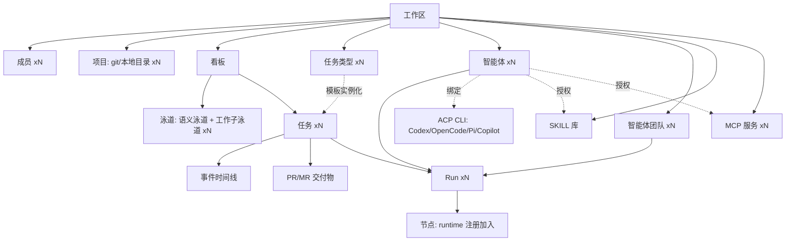
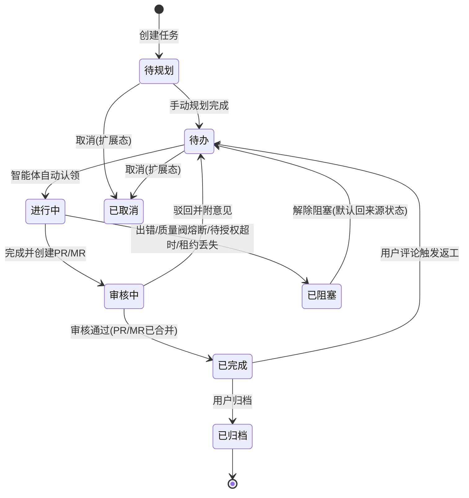
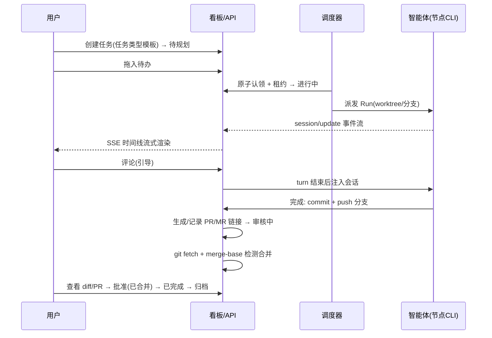
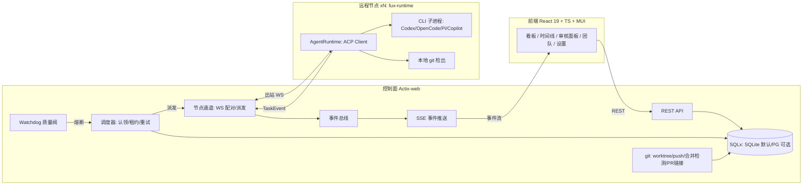

# Fux — AI 工作台 PRD

> 版本：v0.3（决策确认稿）· 2026-11-18
> 定位：以「自驱动看板 + 智能体团队」为核心的 AI 工作台。人定义目标、评审结果；智能体认领任务、执行工作、流式交付过程。
> 核心原则：**不自建 Agent loop**（一切智能体绑定 ACP CLI）、**不接 Git 平台 API**（git 原生 + 用户自理凭据）、**不做集群**（runtime 安装即注册）、**不做成本预算**（以质量阀防失控）。

## 1. 产品概述

### 1.1 要解决的问题

- AI CLI / 编码智能体各自为战：需要在多个终端分别驱动，工作过程不可见、结果难评审、历史难追溯。
- 任务管理与 AI 执行割裂：看板工具不驱动智能体，智能体工具没有任务编排与状态闭环。
- Fux 把「任务 → 认领 → 执行 → PR/MR 审核 → 归档」统一为一条可视化、可干预的流水线。

### 1.2 目标（v1）

| #   | 目标                                                                                            |
| --- | ----------------------------------------------------------------------------------------------- |
| G1  | 工作区内统一管理项目（git / 本地目录）、智能体、SKILL / MCP；支持邀请成员协作                   |
| G2  | 可定制看板（泳道左右滑动）：任务按状态机流转，智能体自动认领并执行                              |
| G3  | 任务全过程可见：GitHub Issue 式时间线 + 流式输出，人可随时评论干预                              |
| G4  | 智能体团队协同工作，团队状态与过程透明                                                          |
| G5  | 通过 ACP 接入 CLI（首批 Codex / OpenCode / Pi / Copilot CLI），每个智能体独立绑定模型与推理强度 |
| G6  | 审核强制对接 PR/MR（git 原生实现），合并检测闭环                                                |
| G7  | 多节点：另一台电脑安装 runtime 即注册加入（WS/SSE），远程执行 CLI；不做集群                     |
| G8  | 质量阀：循环抽搐 / 停滞 / 突然中断的检测与熔断，防止工作失控                                    |

### 1.3 非目标（v1 边界）

- 不做 Git 托管平台，**不接 GitHub / GitLab 等平台 API**：只调用 git CLI，认证 / 代理 / 凭据由用户在执行节点自行配置。
- 不自建 Agent loop、不做直连 LLM API 的内置运行时：所有智能体（含 AI 助理）一律绑定 ACP CLI。
- 不做集群编排（K8s / 分布式共识）：单控制面 + 轻量 runtime 注册，状态集中在控制面。
- 不做多租户 SaaS 与计费；多用户通过工作区邀请 + 角色权限实现。
- 不做成本预算 / 费用管控；以质量阀（FR-13）保障执行不失控。
- 不做模型训练 / 微调；不做通用聊天 IM。

## 2. 核心概念（领域模型）

| 概念                 | 说明                                                                               |
| -------------------- | ---------------------------------------------------------------------------------- |
| Workspace 工作区     | 顶层隔离单元：项目、看板、智能体、SKILL / MCP、成员均归属于工作区                  |
| Member 成员          | 工作区内的用户，角色 owner / admin / member；通过邀请加入                          |
| Project 项目         | 一个 git 仓库（任意 remote）或本地目录；git 凭据用户自理，Fux 只调用 git CLI       |
| Board 看板           | 工作区内的任务看板，由泳道（Lane）组成，横向布局可左右滑动                         |
| Lane 泳道            | 语义泳道（规划/待办/审核/阻塞/完成/归档，均独立）+ 可自定义多个「工作子泳道」      |
| TaskType 任务类型    | 任务模板：标题模板 + 内容（提示词）模板 + 变量槽 + 默认属性                        |
| Task 任务            | 看板卡片；由任务类型实例化或自由创建；状态机驱动流转                               |
| Agent 智能体         | 绑定一个 ACP CLI 条目 + 模型 + 推理强度 + 提示词 + SKILL / MCP 授权（无内置 loop） |
| AgentTeam 智能体团队 | 多智能体编排：流水线（阶段交接）或主管（分派-汇总）两种模式                        |
| Run 运行             | 一次「智能体 × 任务」的执行实例；含 ACP 会话、节点、执行统计、质量阀状态           |
| TaskEvent 任务事件   | 时间线的唯一事实来源：状态变更、消息、工具调用、评论、质量阀事件均为事件           |
| PR/MR 交付物         | 任务分支 + PR/MR 链接 + 合并状态；审核的唯一依据（git 原生检测）                   |
| SKILL                | 以 SKILL.md 为入口的能力包，按智能体授权启用                                       |
| MCP Server           | 外部工具服务（stdio / SSE / Streamable HTTP），按智能体授权 + 工具白名单           |
| Node 节点            | 安装 fux-runtime 后自动注册进来的执行器；承载 Run 与本地仓库检出                   |

## 3. 功能需求

### FR-01 工作区与成员

- 创建 / 重命名 / 删除工作区；工作区是数据隔离边界（所有查询强制带 workspace_id）。
- 工作区设置：默认工具审批策略、默认认领策略、默认质量阀阈值（FR-13）。
- **多用户邀请**：owner / admin 生成邀请链接或邀请码（可设有效期、一次性、预设角色）；受邀者注册 / 登录后接受邀请加入工作区。
- 角色权限（详见 FR-11）：owner（全部 + 成员管理 + 删除工作区）、admin（项目 / 智能体 / 节点配置、审核批准、归档）、member（建任务、评论、规划流转）。
- 工作区概览：项目数、进行中任务数、智能体忙碌状态、成员在线、最近事件。
- 验收：邀请链接过期后不可用；member 无法批准审核或删除工作区；跨工作区不可见任何资源。

### FR-02 项目管理（git + 本地目录）

- 项目两种形态：
  - **git 仓库**：任意 remote URL（GitHub / GitLab / Gitea / 自建均可，Fux 不区分平台）；
  - **本地目录**：git 仓库则用 worktree 隔离；非 git 目录提供一键 `git init`，否则以任务工作副本（目录拷贝）隔离。
- **git 凭据与配置用户自理**：ssh key / credential helper / 代理等由用户在执行节点本地配置好；Fux 只调用 git CLI，不存储 git 凭据、不接平台 API。
- 添加项目时做连接测试（`git ls-remote` / `git status`），失败给出可操作提示（认证 / 网络 / 路径）。
- 每个任务执行在独立分支 `fux/task-<id>`（git 项目用 worktree）中进行，避免并发任务互相污染；多节点下每节点各自检出。
- remote URL 仅用于推导 PR/MR 创建链接（见 3.5.5），不做 API 调用。
- 项目详情页：分支、最近任务、关联 PR/MR 与合并状态。
- 验收：同一项目可被多个任务并发使用而互不冲突；git 认证失败在时间线清晰报错并可阻塞任务。

### FR-03 AI 工作助理

- 工作区级对话侧栏，上下文自动注入：工作区概览、看板状态摘要、进行中任务列表。
- 助理**也是一个绑定 CLI 的智能体**（同 FR-06 配置），不单独实现 loop。
- Fux 提供**内置 MCP Server（workspace 工具集）**：创建任务（选类型填变量）、移动任务、评论、查询看板 / 团队状态；助理通过该 MCP 操作工作台。
- 验收：对话「把刚才讨论的登录 bug 建个任务」→ 助理经 MCP 生成待规划卡片并回显链接。

### FR-04 任务类型管理（任务模板）

- 字段：名称、图标、标题模板、内容（提示词）模板、变量定义（名称/类型/必填/默认值）、默认属性（优先级、标签、目标项目、指派策略、入板泳道）。
- 模板语法：`{{变量名}}`；创建任务时弹出变量表单，实时预览渲染后的标题与内容。
- 支持从现有任务「另存为任务类型」。
- 内置类型示例：Bug 修复、功能开发、代码评审、文档撰写、调研。
- 验收：选类型 → 填 2 个变量 → 一键生成卡片，内容按模板渲染。

### FR-05 自驱动可定制工作看板

#### 3.5.1 泳道模型

- 语义泳道固定且**各自独立**：**规划 | 待办 | 审核中 | 已阻塞 | 已完成 | 已归档**。
- 「进行中」是**可自定义的工作子泳道组**（默认 1 个，可增删、排序、命名，如：编码 → 自测 → 提交 PR）。仅工作子泳道允许多个。
- 每个工作子泳道可配置：WIP 上限、绑定的团队角色 / 智能体（阶段由谁负责）。
- 「已阻塞」为独立泳道（便于人一眼发现需要介入的任务），数据模型记录 `blocked_from`（来源状态），解除阻塞后**回到来源状态**而非一律回待办。
- 「已归档」泳道仅显示近 7 天；归档数据永久保留，提供独立归档检索页（按项目/类型/时间过滤）。
- **横向布局**：泳道定宽，看板整体**左右滚动 / 滑动**（触屏支持）；拖拽卡片到边缘自动滚动；泳道数量不受屏幕限制。
- 看板定制：泳道显隐与排序、卡片字段（标签/负责人/优先级）、按项目/类型/指派过滤。

#### 3.5.2 任务状态机

状态转移规则（全部转移落库为 TaskEvent，非法转移拒绝并报错）：

| #   | 从          | 到                       | 触发                                                       | 执行者       | 副作用                                                  |
| --- | ----------- | ------------------------ | ---------------------------------------------------------- | ------------ | ------------------------------------------------------- |
| T1  | 待规划      | 待办                     | 手动拖拽 / 助理规划完成                                    | 用户         | 进入可认领池                                            |
| T2  | 待办        | 进行中                   | 自动认领成功                                               | 调度器       | 创建 Run、获取租约、绑定 worktree/分支                  |
| T3  | 进行中      | 审核中                   | 智能体报告完成                                             | 智能体       | 提交并推送分支、生成/记录 PR/MR 链接（3.5.5）、通知用户 |
| T4  | 进行中      | 已阻塞                   | 出错 / 质量阀熔断（FR-13）/ 授权超时 / 租约丢失 / 主动求助 | 智能体/系统  | 记录 blocked_from 与原因（含熔断诊断），通知用户        |
| T5  | 审核中      | 已完成                   | 审核通过（检测到合并或人工确认）                           | 用户(admin+) | 记录 merge_commit，可选清理分支                         |
| T6  | 审核中      | 待办                     | 驳回 + 评论                                                | 用户         | 评论作为返工指令，retry_count +1，同分支继续            |
| T7  | 已完成      | 待办                     | 用户评论                                                   | 用户         | 评论成为新一轮工作指令（返工闭环）                      |
| T8  | 已完成      | 已归档                   | 归档                                                       | 用户         | 看板仅显示近 7 天                                       |
| T9  | 已阻塞      | blocked_from（缺省待办） | 解除阻塞 / 评论解答                                        | 用户/系统    | 恢复原状态或重新认领                                    |
| T10 | 待规划/待办 | 已取消                   | 取消                                                       | 用户         | 扩展态，保留记录                                        |
| T11 | 进行中      | 进行中（子泳道间）       | 阶段交接                                                   | 智能体团队   | 工作子泳道间移动，交接上下文                            |

#### 3.5.3 评论语义（按状态区分）

| 任务状态        | 评论效果                                                                                                    |
| --------------- | ----------------------------------------------------------------------------------------------------------- |
| 待规划 / 待办   | 完善任务内容，不触发执行                                                                                    |
| 进行中          | **注入当前运行会话**，引导智能体工作；排队到当前 turn 结束后注入，时间线标注「引导已送达/待送达」（已确认） |
| 审核中          | 作为评审意见；驳回时随 T6 进入返工                                                                          |
| 已阻塞          | 视为对阻塞问题的解答，可自动解除阻塞（T9）                                                                  |
| 已完成          | 触发 T7 返工闭环                                                                                            |
| 已归档 / 已取消 | 只读，评论不改变状态                                                                                        |

#### 3.5.4 自动认领与租约

- 调度器周期扫描待办任务，按认领策略匹配：任务类型 / 标签 / 项目 → 智能体或团队的能力声明；支持「指定指派」与「自动匹配」两种。
- 认领必须是**原子操作**（PG 用 `SELECT ... FOR UPDATE SKIP LOCKED`；SQLite 用事务 + 状态条件更新），多节点 / 多调度器下不重复认领。
- 认领即建立**租约（lease）**：Run 心跳续约（默认 10s 心跳 / 30s 租约，可配）；租约过期 → 任务回待办并 retry_count +1；超过最大重试（默认 3）→ 已阻塞。
- 并发控制：每个智能体默认同时 1 个任务（可配）；工作子泳道受 WIP 上限约束。
- 优先级队列：优先级 > 创建时间；支持暂停 / 恢复某智能体的自动认领。
- 验收：杀掉执行进程后，任务在一个租约周期内自动回到待办并被重新认领。

#### 3.5.5 审核与 PR/MR 强制绑定（git 原生，无平台 API）

- **完成的前提**：代码已提交到 `fux/task-<id>` 并推送 remote。无 remote 的项目必须先配置 remote 才能进入审核（强制 PR/MR 的前提）；纯本地目录项目需一键 `git init` + 配置 remote，或明确降级为本地合并模式（唯一例外，需 admin 确认）。
- **PR/MR 链接来源**：
  1. 从 remote URL 推导创建链接（GitHub compare / GitLab new MR / 通用 fallback），智能体或用户点击创建；
  2. 节点上若装有 `gh` / `glab` 等 CLI，智能体可**自行创建 PR/MR**（这是智能体自身能力，非 Fux 集成），把实际 URL 回填任务；
  3. 用户手动粘贴已有 PR/MR URL。
- **审核面板**：任务详情展示本地 diff（`git diff base...branch`）+ PR/MR 链接 + 合并状态徽标；审核泳道卡片显示 PR/MR 状态。
- **合并检测**：控制面周期 `git fetch` + `git merge-base --is-ancestor <branch> origin/<default>` 判定已合并；检测到合并才允许批准（T5）。无法自动检测时（权限 / 离线）允许 admin **人工确认已合并**，留审计记录。
- 批准 = 确认合并（可选清理分支）；驳回 = 评论返工（T6），智能体在同分支继续工作并更新 PR/MR。
- 验收：未合并的任务无法批准（人工确认除外）；合并被检测到后一键批准即完成闭环。

### FR-06 智能体与智能体团队

#### 3.6.1 智能体配置（一切皆 CLI 绑定）

| 配置项       | 说明                                                                                                 |
| ------------ | ---------------------------------------------------------------------------------------------------- |
| CLI 绑定     | 选择一个 ACP 适配器条目（Codex / OpenCode / Pi / Copilot CLI / 自定义，FR-09）；**无内置 loop**      |
| 模型         | 该 CLI 支持的模型名（每个智能体独立设置）                                                            |
| 推理强度     | minimal / low / medium / high；优先经 ACP 配置项透传（如 OpenCode `effort`），不支持则写入会话提示词 |
| 系统提示词   | 角色人设与 working agreement                                                                         |
| SKILL / MCP  | 从工作区库中勾选授权（FR-08）                                                                        |
| 工具审批策略 | 只读自动 / 写操作需审批 / 全自动（继承工作区默认，可覆盖）                                           |
| 并发         | 最大并发任务数（默认 1）                                                                             |
| 质量阀       | 继承工作区默认阈值，可覆盖（FR-13）                                                                  |

#### 3.6.2 团队编排

- 两种模式：
  - **流水线**：成员按阶段排序（规划 → 执行 → 评审），与自定义工作子泳道对应，阶段完成自动交接（T11），交接附上下文摘要。
  - **主管模式**：lead 智能体拆解任务、分派给成员、汇总结果（v1 提供基础实现）。
- 团队共享上下文：任务内容 + 项目上下文 + 各阶段交接笔记。
- 团队也可被自动认领匹配（能力声明 = 成员能力并集）。

#### 3.6.3 团队工作状态与过程可见

- 团队面板：成员卡片实时显示当前任务、所处阶段、运行状态、执行统计（轮次/耗时）、最近输出摘要。
- 任务时间线内，团队事件按成员着色 / 分组，可过滤「只看某成员」。
- 团队级事件：交接（handoff）、分派（dispatch）、汇总（summary）均入时间线。

### FR-07 任务详情与时间线（GitHub Issue 式）

- 点击卡片打开右侧抽屉 / 详情页：元数据（状态、类型、项目、指派、优先级、标签、PR/MR）+ 时间线 + 评论输入框。
- 时间线事件类型：`task.created / task.moved / run.started / agent.message / agent.thought / tool.call / tool.result / plan.updated / permission.requested / permission.resolved / comment.added / run.finished / task.blocked / pr.linked / pr.merged_detected / watchdog.loop / watchdog.stalled / watchdog.interrupted / usage.updated`。
- **流式输出**：`agent.message` 分片实时追加渲染；工具调用折叠展示（名称、参数摘要、状态图标、耗时），diff 类结果渲染为代码差异视图。
- 权限请求渲染为可操作卡片（批准 / 拒绝 / 始终允许该工具），超时按策略处理。
- **PR/MR 审核面板**：diff 视图 + PR/MR 链接 + 合并状态 + 批准 / 驳回按钮（3.5.5）。
- 质量阀熔断显示诊断卡片：触发原因、最近事件快照、建议操作（FR-13）。
- 断线重连：SSE 携带 `Last-Event-ID`，从事件序号续传，不丢消息。
- 评论区支持 Markdown、@智能体（定向引导）、附件（图片 / 文件）。
- 验收：任务执行中打开面板即可看到逐字输出；刷新页面后时间线完整回放。

### FR-08 SKILL / MCP 管理

- SKILL：
  - 工作区 SKILL 库：导入（本地目录 / Git 仓库 / 上传 zip），以 SKILL.md 为入口，记录名称、描述、版本。
  - 按智能体授权启用；运行时写入会话工作目录（如 `.fux/skills/`）并在系统提示词中引用（所有智能体均为 ACP CLI，注入方式统一）。
- MCP：
  - 注册 MCP Server：传输方式 stdio / SSE / Streamable HTTP，命令或 URL、env / headers（密钥走引用）。
  - 健康检查与工具列表探测；按智能体授权 + **工具白名单**。
  - ACP 会话创建时把授权的 MCP Server 透传给 CLI（`session/new` 的 mcpServers）；**按 CLI 能力适配**（如 OpenCode 支持 stdio / HTTP，不支持 SSE，注册时提示兼容性）。
  - Fux 内置 workspace MCP Server（FR-03 助理使用，也可授权给其他智能体）。
- 验收：给智能体勾选某 MCP 后，其工具调用出现在时间线且受白名单约束。

### FR-09 ACP 接入 CLI（首批 Codex / OpenCode / Pi / Copilot CLI）

- Fux 作为 **ACP Client**（协议：JSON-RPC 2.0 over stdio，newline-delimited）；CLI 子进程运行在任务所在节点（本地或远程 runtime，见 FR-10）。
- 方法映射：

| ACP 方法                            | Fux 用途                                                                                                |
| ----------------------------------- | ------------------------------------------------------------------------------------------------------- |
| `initialize`                        | 协议版本与能力协商（loadSession、prompt / MCP 能力等）                                                  |
| `session/new`                       | cwd = 任务 worktree（绝对路径）；透传授权的 MCP Servers                                                 |
| `session/prompt`                    | 下发任务内容；进行中的引导评论作为后续 prompt 注入                                                      |
| `session/update`                    | `agent_message_chunk / agent_thought_chunk / tool_call / tool_call_update / plan` → 映射为 TaskEvent 流 |
| `session/request_permission`        | 生成审批卡片（FR-07），按策略自动或人工决策                                                             |
| `session/cancel`                    | 暂停 / 取消任务；质量阀熔断时调用                                                                       |
| `session/load`（可选能力）          | 恢复历史会话（OpenCode / Copilot CLI 支持）；不支持时以时间线摘要重建上下文                             |
| `session/set_config_option`（可选） | 设置模型 / 推理强度（OpenCode 提供 `model` / `effort` 配置项）                                          |

- 适配器注册表（命令 + 参数 + env 模板），首批四条：
  - **Codex**：经 `codex-acp` 适配器（ACP 官方仓库维护）。
  - **OpenCode**：原生 ACP，`opencode acp`（调试可加 `--print-logs`，日志走 stderr）。
  - **Pi**：经 `pi-acp` 适配器（桥接 `pi --mode rpc`）。
  - **Copilot CLI**：原生 ACP（public preview），`copilot --acp --stdio`；安装 `npm i -g @github/copilot`。推理强度经**启动参数** `--effort=low|medium|high|xhigh|max` 注入（该参数作用于进程内所有会话、不可经 `session/new` 修改；Fux 每 Run 独立起进程，按智能体配置拼装启动参数）；工具白名单可映射启动参数 `--available-tools` / `--excluded-tools`；模型经 `/model` 命令（作为 ACP prompt 下发）设置。
  - 允许用户自定义任意 ACP 兼容 CLI 条目。
- 模型 / 推理强度：优先 ACP 配置项透传（OpenCode `model` / `effort`）或启动参数注入（Copilot CLI `--effort`）；均不支持时写入会话提示词，并在 Run 中记录实际生效值。
- **CLI 认证用户自理**：在节点上完成（如 `opencode auth login`、codex 登录、pi 供应商配置、copilot 交互模式 `/login` 或 `COPILOT_GITHUB_TOKEN` 环境变量；Copilot CLI 亦支持 BYOK 供应商配置，免 GitHub 登录）；Fux 捕获 `auth_required` → 时间线提示卡片 + 节点页标记认证状态。
- 进程治理：崩溃 / EOF 检测 → 质量阀中断路径（FR-13）；stdout 协议流与 stderr 日志分离。
- 验收：同一任务可分别用 Codex / OpenCode / Pi / Copilot CLI 执行，时间线呈现一致；模型与推理强度按智能体配置生效。

### FR-10 多节点（runtime 安装即注册，非集群）

- 形态：**单控制面 + N 个轻量执行节点**。状态全部集中在控制面（SQLite 默认，PG 可选），无分布式共识 / 编排；节点是无状态执行器。
- **加入流程（零复杂配置）**：
  1. 控制面节点页生成**一次性配对码**（附控制面地址，可展示为二维码 / 一行命令）；
  2. 另一台可访问的电脑安装 `fux-runtime`（单二进制 / 一行安装脚本），执行 `fux-runtime join <地址> --code <配对码>`；局域网内可选 mDNS 自动发现控制面，只需输配对码；
  3. runtime 建立**出站 WebSocket 长连接**（SSE + REST 回退），自动上报能力：OS、已安装 CLI（探测 codex / opencode / pi / copilot）、本地项目目录、负载；
  4. admin 在节点页**一键批准** → 节点上线可调度。全程无需在远程机器开入站端口、无需配置 SSH / 反代（NAT 友好）。
- 通道职责（WS 双向）：Run 派发（ACP stdio 帧转发）、事件上报、心跳与租约续约、能力变更上报。
- 断线治理：WS 自动重连（指数退避）；失联 → 其租约过期任务按 FR-05 规则回收。
- 调度亲和：优先已有该项目检出的节点 → 具备所需 CLI 的节点 → 负载均衡。
- SSH 直连模式**不在 v1**（列为后续可选：针对无法安装 runtime 的机器）。
- 验收：一台全新机器从安装到上线 ≤ 5 分钟；任务可调度到该节点的 CLI 执行并流式回传；拔网线后任务自动回收。

### FR-11 权限与安全

- 账号体系：注册 / 登录（密码 argon2id 哈希，会话 JWT / Cookie）；邀请码一次性 / 可过期。
- 角色权限矩阵：

| 操作                             | owner |      admin      | member |
| -------------------------------- | :---: | :-------------: | :----: |
| 建任务 / 评论 / 规划→待办        |   ✓   |        ✓        |   ✓    |
| 审核批准（T5）/ 驳回 / 归档      |   ✓   |        ✓        |   ✗    |
| 项目 / 智能体 / SKILL / MCP 配置 |   ✓   |        ✓        |   ✗    |
| 节点批准 / 配对码生成            |   ✓   |        ✓        |   ✗    |
| 成员邀请 / 移除 / 角色变更       |   ✓   | ✓(不可改 owner) |   ✗    |
| 删除工作区                       |   ✓   |        ✗        |   ✗    |

- 节点安全：配对码一次性 + admin 批准；每节点独立通道令牌；runtime 只执行控制面派发的白名单命令。
- 密钥库：仅存 MCP env / headers 等密钥（AES-GCM，主密钥来自部署环境变量）；**git 与模型凭据不经 Fux 存储**（用户在节点自理）；API 永不回传明文。
- 工具审批策略三级：只读自动 / 写操作需审批 / 全自动；审批请求与决策全部入时间线（审计）。
- 任务 worktree / 工作副本隔离，禁止越界写项目目录之外路径（策略可配）。
- 全量操作审计：谁（用户/智能体/系统）在何时对什么做了什么 → TaskEvent / 审计日志。

### FR-12 通知与可观测

- 通知触发：任务进入审核中 / 已阻塞、**质量阀熔断**、权限请求待审批、**PR/MR 检测到合并**、返工被认领、成员邀请。渠道：应用内通知中心（v1），Webhook（可选）。
- 运行统计（仅展示，**无预算管控**）：每 Run 的轮次 / 耗时 / token 数（若 CLI 上报）。
- 节点页：在线状态、配对审批、能力清单、CLI 认证状态、负载、运行中 Run、最近错误。

### FR-13 质量阀（工作失控熔断）

- 每个 Run 由 **watchdog** 监护（事件驱动 + 周期扫描），阈值工作区级默认、智能体级可覆盖：

| 阀            | 检测信号                                                               | 默认阈值                     | 动作                                                                      |
| ------------- | ---------------------------------------------------------------------- | ---------------------------- | ------------------------------------------------------------------------- |
| 循环 / 抽搐   | 连续相同工具调用（名称+参数哈希）；重复相同输出片段；文件编辑↔回退振荡 | 连续 5 次相同调用 / 3 次振荡 | 熔断，**不自动重试**（避免再入循环）                                      |
| 停滞 / 无进展 | 事件静默；或有事件但无实质进展（无文件变更 / plan 不前进）             | 静默 120s；无进展 10min      | 先注入提醒 prompt → 仍无进展则熔断                                        |
| 突然中断      | CLI 进程退出 / stdio EOF / 节点通道断开 / 协议错误 / 模型错误流        | 即时                         | Run 失败 → **自动重试 ≤ 2 次**（新会话 + 时间线摘要上下文）→ 仍失败则阻塞 |
| 硬上限        | 最大轮次 / 最长墙钟时间                                                | 200 轮 / 60min               | 熔断                                                                      |

- 熔断动作：`session/cancel`（必要时 kill 进程）→ T4 已阻塞 + **诊断卡片**（触发原因、最近事件快照、建议操作）→ 通知用户。
- 所有阀事件（`watchdog.*`）入时间线，可审计、可回放；误报场景（如合法的重复测试运行）可通过阈值 / 白名单调整。
- 验收：构造循环调用的 mock agent → 阈值内熔断并阻塞；kill CLI 进程 → 自动重试或阻塞；长时间静默 → 停滞阀触发。

## 4. 关键流程（用户故事精化）

### 4.1 准备阶段

1. 注册 / 登录 → 新建工作区 → 邀请成员。
2. 配置默认审批策略与质量阀阈值。
3. 添加项目（git URL / 本地目录）；在执行节点自行配置好 git（认证 / 代理），连接测试通过。
4. 在节点安装并认证 CLI（codex / opencode / pi / copilot）。
5. 导入 SKILL、注册 MCP Server。
6. 创建智能体（绑定 CLI + 模型 + 推理强度，授权 SKILL 与 MCP）；按需组建团队。
7. 定义任务类型模板；定制看板工作子泳道。
8. （可选）另一台电脑安装 fux-runtime，配对码加入。

### 4.2 任务生命周期

### 4.3 返工与阻塞干预

- 已完成任务评论 → 回待办 → 自动认领 → 新一轮 Run（时间线按 Run 分组，历史保留；同分支继续，PR/MR 自动更新）。
- 阻塞任务：时间线顶部显示阻塞原因卡片（错误 / 质量阀诊断 / 待回答问题 / 待审批），用户评论解答或点击解除 → 回来源状态继续。

## 5. 技术架构

### 5.1 总体架构

### 5.2 后端（Actix-web + SQLx）

- 模块划分：`api`（REST/SSE）、`auth`（账号/邀请/角色）、`domain`（状态机、认领策略）、`scheduler`（租约/重试）、`runtime`（ACP Client：本地子进程 / 节点通道转发，**唯一运行时形态**）、`watchdog`（质量阀）、`git`（worktree / push / 合并检测 / PR 链接推导）、`nodes`（配对 / WS 通道 / 能力）、`store`（SQLx 仓储）、`events`（事件总线 + 持久化）。
- **事件溯源式时间线**：TaskEvent 为唯一事实来源，任务当前状态是事件投影；所有变更先写事件再更新投影，天然支持回放与 SSE 续传。
- 状态机集中在 domain 层实现为显式转移表（见 3.5.2），API 与调度器共用，杜绝非法转移。
- SSE 通道：`/tasks/{id}/events`（时间线）、`/workspaces/{id}/events`（看板变更）；事件带单调序号，支持 Last-Event-ID。
- 节点通道：出站 WS（节点 → 控制面），承载 ACP stdio 帧转发与心跳；SSE + REST 回退。
- SQLx：编译期查询校验；**SQLite 默认**（状态集中控制面，多节点同样适用），PG 可选；迁移脚本双方言兼容。

### 5.3 前端（React 19 + TS + Material Design / MUI）

- 组件库：**MUI（Material UI）**，Material Design 规范；主题定制（暗色 / 亮色）。
- 页面：工作区列表 / 看板页 / 任务抽屉（时间线 + 评论 + PR/MR 审核面板）/ 团队面板 / 智能体与 SKILL/MCP 设置 / 成员与邀请 / 节点页（配对）/ 助理侧栏。
- **看板横向滚动**：泳道定宽 + 横向滚动容器，触屏左右滑动，拖拽（dnd-kit）到边缘自动滚动；拖拽即调用状态转移 API，非法转移即时回滚并提示。
- 状态：服务端状态用 TanStack Query；SSE 事件驱动增量更新（看板卡片移动、时间线追加）。
- 流式渲染：消息分片合并渲染、工具调用折叠组件、diff 视图、审批卡片、质量阀诊断卡片。

### 5.4 数据模型（核心表）

| 表                              | 关键字段                                                                                                                                                                                                                       |
| ------------------------------- | ------------------------------------------------------------------------------------------------------------------------------------------------------------------------------------------------------------------------------ |
| users                           | id, username/email, password_hash(argon2id), display_name, created_at                                                                                                                                                          |
| workspace_members               | workspace_id, user_id, role(owner/admin/member), joined_at                                                                                                                                                                     |
| invitations                     | workspace_id, code, role, expires_at, one_time, created_by, status                                                                                                                                                             |
| workspaces                      | id, name, settings(json: 审批策略/认领策略/质量阀默认), created_at                                                                                                                                                             |
| projects                        | id, workspace_id, name, kind(git/local), remote_url/local_path, default_branch（无凭据字段，git 用户自理）                                                                                                                     |
| boards / lanes                  | board: workspace_id, config；lane: board_id, kind(planning/ready/work/review/blocked/done/archived), name, position, wip_limit, stage_role                                                                                     |
| task_types                      | id, workspace_id, name, title_template, content_template, variables_schema(json), defaults(json)                                                                                                                               |
| tasks                           | id, board_id, type_id, project_id, title, content, status, blocked_from, lane_id, priority, tags, assignee, branch, pr_url, pr_state(open/merged/closed), merge_commit, retry_count, lease_owner, lease_expires_at, timestamps |
| task_events                     | task_id, seq(单调), kind, actor(user/agent/system), run_id, payload(json), created_at                                                                                                                                          |
| cli_entries                     | id, workspace_id(或全局), name, kind(codex/opencode/pi/copilot/custom), command, args, env_template                                                                                                                            |
| agents                          | id, workspace_id, name, cli_entry_id, model, reasoning_effort, system_prompt, policy(json), gates(json), max_concurrent                                                                                                        |
| agent_teams / team_members      | team: mode(pipeline/supervisor)；member: team_id, agent_id, role, position                                                                                                                                                     |
| skills / agent_skills           | skill: workspace_id, name, source, version；授权关系表                                                                                                                                                                         |
| mcp_servers / agent_mcp_servers | server: transport, command/url, secret_refs, status；授权 + tool_whitelist                                                                                                                                                     |
| runs                            | id, task_id, agent_id/team_id, node_id, acp_session_id, status, stop_reason(watchdog/...), turn_count, last_event_at, retry_of, usage(tokens, 仅展示), started_at, ended_at                                                    |
| nodes                           | id, name, mode(runtime), conn_status, capabilities(json: os/clis/project_paths), last_heartbeat, status(pending/online/offline), approved_by                                                                                   |
| pairing_tokens                  | code, expires_at, one_time, created_by, used_by_node                                                                                                                                                                           |
| secrets                         | id, workspace_id, key, encrypted_value（仅 MCP 等密钥）                                                                                                                                                                        |
| approvals                       | id, run_id, request(json), status, decided_by, decided_at                                                                                                                                                                      |

### 5.5 API 概览（REST `/api/v1`）

| 资源                | 端点示例                                                                                                                            |
| ------------------- | ----------------------------------------------------------------------------------------------------------------------------------- |
| 认证 / 我           | `POST /auth/register`，`POST /auth/login`，`GET /me`                                                                                |
| 工作区 / 成员       | `GET/POST /workspaces`，`GET/POST /workspaces/{id}/members`，`POST /workspaces/{id}/invitations`，`POST /invitations/{code}/accept` |
| 项目                | `POST /workspaces/{id}/projects`，`POST /projects/{id}/test-connection`                                                             |
| 看板 / 泳道         | `GET /boards/{id}`，`PUT /boards/{id}/lanes`                                                                                        |
| 任务类型            | `GET/POST /task-types`，`POST /task-types/{id}/instantiate`                                                                         |
| 任务                | `GET/POST /tasks`，`POST /tasks/{id}/transition`，`POST /tasks/{id}/comments`，`POST /tasks/{id}/archive`                           |
| PR/MR               | `GET/POST /tasks/{id}/pull-request`（链接/状态），`POST /tasks/{id}/check-merge`                                                    |
| 审批                | `POST /approvals/{id}/decide`                                                                                                       |
| 智能体 / 团队 / CLI | `GET/POST /agents`，`GET/POST /teams`，`GET/POST /cli-entries`，`POST /cli-entries/{id}/probe`，`POST /agents/{id}/pause`           |
| SKILL / MCP         | `GET/POST /skills`，`GET/POST /mcp-servers`，`POST /mcp-servers/{id}/probe`                                                         |
| 节点                | `GET /nodes`，`POST /nodes/pairing-codes`，`POST /nodes/{id}/approve`，`DELETE /nodes/{id}`                                         |
| 助理                | `POST /assistant/chat`（SSE 响应）                                                                                                  |
| 事件流              | `GET /tasks/{id}/events`（SSE），`GET /workspaces/{id}/events`（SSE）                                                               |

内部接口（runtime ↔ 控制面）：`/node-channel`（出站 WS：配对认证、能力上报、Run 派发 / ACP 帧转发 / 事件上报 / 心跳租约续约）。

## 6. 非功能需求

| 维度   | 要求                                                                                      |
| ------ | ----------------------------------------------------------------------------------------- |
| 实时性 | 事件产生 → 前端呈现 < 500ms；看板操作响应 < 200ms                                         |
| 可靠性 | 进程崩溃 / 节点失联后，任务在一个租约周期内回收；WS 自动重连；SSE 断线续传不丢事件        |
| 质量   | 质量阀（FR-13）覆盖循环 / 停滞 / 中断 / 硬上限；熔断与重试全部可审计                      |
| 一致性 | 状态转移与认领均为原子操作；事件序号单调，投影可从事件重建；多人并发转移用版本号乐观锁    |
| 安全   | 密钥加密存储、不回传明文；工具审批与审计全覆盖；节点配对一次性码 + 批准；子进程命令白名单 |
| 可维护 | SQLx 编译期校验；状态机单点实现；ACP 适配器可插拔；无自建 loop                            |
| 兼容   | runtime 支持 Windows / Linux / macOS；控制面 Linux / Windows；SQLite 默认、PG 可选        |

## 7. 里程碑（均在 v1 范围内）

| 阶段                         | 范围                                                                                                                                            | 验收标准                                                                    |
| ---------------------------- | ----------------------------------------------------------------------------------------------------------------------------------------------- | --------------------------------------------------------------------------- |
| M0 骨架                      | Actix-web + SQLx 迁移 + React(MUI) 脚手架；账号注册登录；工作区 / 项目（git/本地）CRUD                                                          | 注册后创建工作区并添加 git 项目，连接测试通过                               |
| M1 手动看板 + 协作           | 看板 / 泳道（横向滚动）/ 任务 / 任务类型；手动拖拽；评论时间线；归档 7 天过滤；成员邀请与角色                                                   | 模板建卡 → 手动走完全流程；邀请成员并按角色限权                             |
| M2 单智能体 + PR/MR + 质量阀 | ACP Client + OpenCode 跑通；自动认领 + 租约；SSE 流式时间线；评论引导；push + PR/MR 链接 + 合并检测 + 返工闭环；质量阀（中断/硬上限/循环/停滞） | 待办任务自动执行并流式可见；未合并不可批准；杀进程自动回收；mock 循环被熔断 |
| M3 多 CLI + SKILL/MCP        | Codex / Pi / Copilot CLI 适配 + 注册表；模型 / 推理强度配置；审批卡片；SKILL/MCP 管理与授权；内置 workspace MCP                                 | 四个 CLI 各跑通一个任务；MCP 工具受白名单约束；助理经 MCP 建卡              |
| M4 团队                      | 流水线 / 主管编排；多工作子泳道；团队状态面板                                                                                                   | 团队按阶段交接完成任务，成员过程可按人过滤查看                              |
| M5 多节点                    | fux-runtime 配对加入（WS）；能力注册；亲和调度；租约回收                                                                                        | 全新机器 ≤ 5 分钟上线；任务分发到远程节点 CLI 执行；节点下线任务自动回收    |

## 8. 决策记录与剩余风险

### 8.1 已确认决策

| #   | 决策                                                                                    |
| --- | --------------------------------------------------------------------------------------- |
| 1   | 前端 UI = Material Design（MUI）                                                        |
| 2   | 「已阻塞」保留独立泳道；看板泳道左右滑动即可                                            |
| 3   | ACP 首批适配 Codex / OpenCode / Pi / Copilot CLI（默认内置条目）                        |
| 4   | 多节点 = runtime 安装即注册（WS/SSE 出站，免复杂配置）；不做集群；SSH 非必需（v1 不做） |
| 5   | 审核强制对接 PR/MR；以 git 原生方式实现（推分支 + 链接 + 合并检测），不接平台 API       |
| 6   | 不做成本预算；改为质量阀（循环抽搐 / 停滞 / 突然中断 / 硬上限熔断）                     |
| 7   | 进行中评论注入时机 = 排队到当前 turn 结束后注入，时间线标注送达状态                     |
| 8   | 多用户：工作区内邀请成员，owner / admin / member 三角色                                 |
| 9   | 项目 = git 仓库 + 本地目录；git 凭据 / 配置用户本地自理，不区分 GitHub / GitLab         |
| 10  | 不实现内置 Agent loop：所有智能体（含助理）直接绑定 CLI + 模型 + 推理强度               |

### 8.2 剩余风险

| #   | 风险                                                                                 | 缓解                                                      |
| --- | ------------------------------------------------------------------------------------ | --------------------------------------------------------- |
| 1   | codex-acp / pi-acp 为第三方适配器；Copilot CLI ACP 尚处 public preview，接口可能变动 | 锁定版本 + 集成冒烟测试；initialize 能力协商兜底          |
| 2   | 合并检测依赖 fetch 权限与默认分支正确性                                              | 人工确认已合并兜底（admin，留审计）；项目配置校验默认分支 |
| 3   | 循环检测误报（合法的重复测试 / 重试）                                                | 阈值可配 + 工具白名单；熔断诊断卡片支持一键恢复           |
| 4   | 节点 CLI 认证过期 / 漂移                                                             | auth_required 捕获 + 节点页认证状态 + 上线前 probe        |
| 5   | 多用户并发操作冲突                                                                   | 状态转移版本号乐观锁；冲突即时提示刷新                    |
| 6   | runtime 跨平台差异（Windows 路径 / CLI 探测）                                        | M5 验收覆盖 Windows / Linux；能力上报标准化               |

## 附录 A：设计演进对照（原始设计 → 当前方案）

| 原设计                                           | 当前方案                                                                                        | 理由                                                                  |
| ------------------------------------------------ | ----------------------------------------------------------------------------------------------- | --------------------------------------------------------------------- |
| 泳道：规划\|待办\|工作xN\|审核\|阻塞\|完成\|归档 | 七类语义泳道均独立 + 可定制工作子泳道组（WIP + 角色绑定）；阻塞记录来源状态可回退；看板左右滑动 | 多工作泳道有明确语义（阶段/角色），阻塞恢复不丢上下文，泳道多时不拥挤 |
| 已归档只显示近七天                               | 显示过滤 ≠ 数据删除；归档永久保留 + 独立检索页                                                  | 审计与返工追溯需要历史                                                |
| 自动认领（未定义机制）                           | 原子认领 + 租约心跳 + 重试上限 + 能力匹配                                                       | 多节点 / 崩溃场景下不重复认领、不丢任务                               |
| 评论引导 / 评论返工                              | 按状态细化评论语义表（含阻塞解答、审核驳回、turn 结束注入）                                     | 覆盖原设计未定义的边界状态                                            |
| 时间线流式输出                                   | 事件溯源 TaskEvent + SSE 序号续传                                                               | 断线不丢消息，历史可回放，团队过程天然可见                            |
| GitHub / GitLab / 本地项目 + 平台凭据            | git 仓库 + 本地目录；git 用户自理；PR/MR 强制但 git 原生实现（链接 + 合并检测）                 | 砍掉平台 API 集成面，认证交给用户本地 git，审核闭环不打折             |
| 内置运行时 + ACP 双形态                          | 一切智能体绑定 ACP CLI（Codex/OpenCode/Pi/Copilot）+ 模型 + 推理强度；助理经内置 MCP 操作工作台 | 不重复造 Agent loop，复用成熟 CLI 的模型接入与工具能力                |
| 多节点（集群式预留）                             | 单控制面 + runtime 安装即注册（出站 WS，配对码 + 一键批准）；状态集中 SQLite                    | 免复杂配置、NAT 友好；无集群复杂度                                    |
| Token 预算 / 成本控制                            | 移除；质量阀：循环 / 停滞 / 中断 / 硬上限熔断 + 诊断卡片                                        | 用户无预算诉求；失控防护比费用上限更关键                              |
| 单用户                                           | 多用户：账号 + 工作区邀请 + owner/admin/member 权限矩阵                                         | 团队协作是工作台天然场景                                              |
| （未提及）                                       | 任务级 git worktree 隔离、密钥库（仅 MCP）、工具审批、已取消扩展态、通知中心                    | 并发安全与 AI 执行安全是工作台落地前提                                |